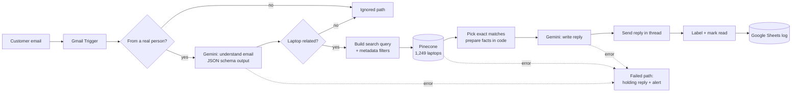

# AI Email Assistant for Laptop Enquiries

An automated customer-support assistant that **reads laptop enquiry emails, finds the right products in a vector database, and replies on its own** in the same email thread. Built with **n8n**, **Pinecone** and **Google Gemini**.

   

---

## Example

**Customer email**
> Hi, can you please suggest a few good HP gaming laptops released in 2026?

**Automatic reply** (sent about a minute later, in the same thread)
```
Hi Pavan,

Here are a few good HP gaming laptops released in 2026:

- HP Omen 17-an012dx | Intel Core i7 7700HQ 2.8GHz | 12GB RAM | 1TB HDD | AMD Radeon RX 580 | 17.3" 1920x1080 | launched 2026 | $1954.68

- HP Omen 17-W295 | Intel Core i7 7700HQ 2.8GHz | 16GB RAM | 256GB SSD + 1TB HDD | Nvidia GeForce GTX 1050 | 17.3" 1920x1080 | launched 2026 | $1541.17

...

Best regards,
Laptop Enquiry Team
```

---

## Features

- **Answers real customer questions:** prices, specifications, recommendations by brand, type, budget, RAM or launch year
- **Handles many versions:** e.g. "the Legion Y520 comes in 19 versions priced from $870.61 to $1562.40"
- **Several laptops in one email:** each one is searched and answered
- **Never a dead end:** if a laptop or brand isn't available, it suggests close alternatives from other models or brands
- **Skips spam and automated senders** to prevent unwanted replies and reply loops
- **Error handling:** retries, a backup AI model, a polite holding reply to the customer, and an alert email to the team
- **Full traceability:** every email is labelled in Gmail (`Processed` / `Ignored` / `Failed`) and logged in Google Sheets

---

## Architecture



### How it works

| # | Step | What happens |
|---|---|---|
| 1 | **Receive** | n8n checks the Gmail inbox every minute and processes one email at a time |
| 2 | **Filter** | Automated senders (no-reply, alerts, newsletters) are skipped before any AI call |
| 3 | **Understand** | Gemini turns the email into structured data: category, laptop models, what the customer wants, and filters |
| 4 | **Query** | Code builds a Pinecone search with metadata filters, e.g. `Company = HP AND Type_Name = Gaming AND Launch_Year = 2026` |
| 5 | **Search** | Pinecone finds laptops by meaning; code then keeps only exact model matches |
| 6 | **Prepare facts** | Code counts versions, calculates price ranges and formats each laptop as a ready-made line |
| 7 | **Reply** | Gemini writes the friendly wording around those lines; Gmail sends it, labels it, and the sheet logs it |

> **Design principle:** *code handles the facts, AI handles the wording.* Gemini never calculates or chooses prices, so every number in a reply matches the database.

---

## Tech stack

| Tool | Role |
|---|---|
| [n8n](https://n8n.io) (self-hosted on Docker) | Workflow automation |
| [Pinecone](https://www.pinecone.io) | Vector database with built-in embeddings (`llama-text-embed-v2`) |
| [Google Gemini](https://ai.google.dev) (Flash) | Email understanding and reply writing |
| Gmail API + Google Sheets API (OAuth 2.0) | Email in/out, labels, logging |
| JavaScript (n8n Code nodes) | Query building, matching, fact preparation |
| Python (pandas) | Dataset cleaning |

---

## Repository structure

```
├── workflows/
│   ├── 1_Load_Laptops_into_Pinecone.json   # one-time data load
│   └── 2_Laptop_Email_Assistant.json       # main email assistant
├── data/
│   └── laptop.csv                          # cleaned dataset (1,249 laptops)
├── scripts/
│   └── clean_data.py                       # dataset cleaning script
├── docs/
│   ├── Write-up.pdf                        # 2-page project overview
│   └── screenshots/
└── README.md
```

---

## Dataset

Source: [Kaggle laptop price dataset](https://www.kaggle.com/) (1,303 rows).

Cleaning (`scripts/clean_data.py`):
- Removed 28 duplicate rows and merged 26 same-laptop listings → **1,249 laptops**
- Standardised brand spellings (`Thinkpad` → `ThinkPad`) and cleaned broken product names
- Converted prices from EUR to **USD** (1 EUR = 1.1176 USD, Oct 2026)
- Converted `RAM` and `Weight` to numeric columns (`RAM_GB`, `Weight_kg`)
- Added **`Launch_Year` (simulated, 2016–2026)** so "new/latest laptop" questions can be demonstrated

> ⚠️ `Launch_Year` values are simulated for demo purposes. The hardware itself is from around 2016–2018.

Each laptop is stored in Pinecone as:
- **`text`:** a descriptive sentence that is turned into a vector for meaning-based search
- **metadata:** company, product, type, CPU, RAM, storage, GPU, price, launch year, etc., used for exact filters and for building replies

---

## Setup

### Prerequisites
- [Docker Desktop](https://www.docker.com/products/docker-desktop/)
- A Gmail account to act as the support inbox
- A [Google Cloud](https://console.cloud.google.com) project
- A [Gemini API key](https://aistudio.google.com) and a [Pinecone](https://app.pinecone.io) account (free tiers are enough)

### 1. Run n8n
```bash
docker volume create n8n_data
docker run -d --name n8n -p 5678:5678 -e GENERIC_TIMEZONE=Asia/Kolkata -e TZ=Asia/Kolkata -v n8n_data:/home/node/.n8n --restart unless-stopped docker.n8n.io/n8nio/n8n
```
Open http://localhost:5678 and create an owner account.

### 2. Google Cloud (Gmail + Sheets access)
1. Enable the **Gmail API**, **Google Sheets API** and **Google Drive API**.
2. Configure the **OAuth consent screen** (External, Testing) and add your inbox as a **test user**.
3. Create an **OAuth client ID** (Web application) with the redirect URI `http://localhost:5678/rest/oauth2-credential/callback`.

### 3. Pinecone
Create an index named `laptops` with the integrated embedding model **`llama-text-embed-v2`**, field map **`text`**, on AWS `us-east-1`. Copy its **host**.

### 4. n8n credentials
| Credential | Type |
|---|---|
| Gmail account | Gmail OAuth2 API (Client ID + Secret) |
| Google Sheets account | Google Sheets OAuth2 API (same Client ID + Secret) |
| Gemini API | Google Gemini (PaLM) API key |
| Pinecone API | Header Auth: name `Api-Key`, value = your Pinecone key |

### 5. Load the data
```bash
docker exec n8n mkdir -p /home/node/.n8n-files
docker cp data/laptop.csv n8n:/home/node/.n8n-files/laptop.csv
```
Import `workflows/1_Load_Laptops_into_Pinecone.json`, paste your Pinecone host into the **Settings** node, select the credentials, and run it. Pinecone should show **1,249 records**.

### 6. Configure the main workflow
1. Create a Google Sheet with a `Log` tab and these headers:
   `Timestamp | Message ID | From | Subject | Customer Question | Category | Status | Laptops Matched | Reply Sent | Error`
2. Create Gmail labels: `Processed`, `Ignored`, `Failed`.
3. Import `workflows/2_Laptop_Email_Assistant.json` and update:
   - the Pinecone host in **Search Pinecone**
   - your inbox address in **From a real person?**
   - the alert address in **Alert Me**
   - the sheet and labels in the Google Sheets and Gmail nodes
4. Select the credentials, **Save**, then **Publish**.

Send a test email to your support inbox, and you should get a reply within a minute or two.

---

## Edge cases

| Situation | Behaviour |
|---|---|
| Laptop not found | Polite reply with 3 different close alternatives |
| Brand has no match (e.g. Toshiba gaming 2026) | Backup search without the brand → alternatives from other brands |
| Many versions of one model | Version count + price range + up to 6 versions spread across the range |
| Unrelated email or automated sender | No reply; labelled `Ignored` and logged |
| AI or database failure | Retries → holding reply to the customer → alert to the team → labelled `Failed` and logged |

---

## Testing

Every path was tested end-to-end with live emails, and every price and spec in the replies was checked against the dataset:

✅ Single laptop with many versions · ✅ Specifications request · ✅ Two laptops in one email · ✅ Filtered recommendations (brand + type + year) · ✅ Laptop not found · ✅ Brand not available → other brands · ✅ Unrelated email ignored · ✅ Automated sender ignored · ✅ Failure path (real Gemini overload)

---

## Lessons learned

- **Don't let an LLM handle numbers it can get wrong.** An early reply mixed up two nearly identical versions and quoted a wrong price. Moving all facts and calculations into code fixed it completely.
- **Plan for AI outages.** Free-tier models get overloaded; retries plus a backup model made the system reliable.
- **Vector search finds *similar*, not *exact*.** Combining semantic search with metadata filters and an exact-match step gave accurate answers.

---

## Future improvements

- Host n8n on a cloud server for 24/7 operation
- Read the full email thread so follow-up questions ("what about the 16GB version?") keep their context
- Use real launch dates and live prices from a product database
- Branded HTML email templates and a dashboard on top of the log

---

## Author

**R V Pavan**: [LinkedIn](https://www.linkedin.com/in/your-profile)
